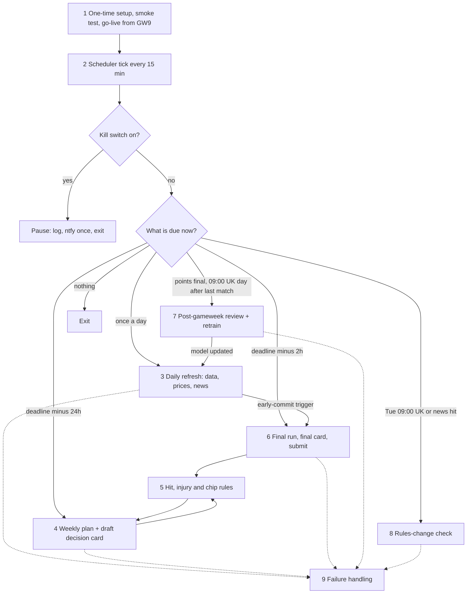
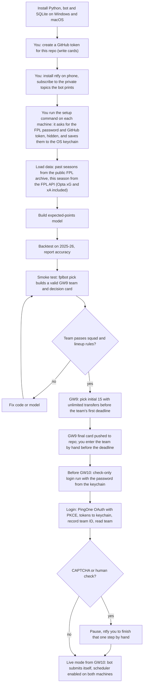
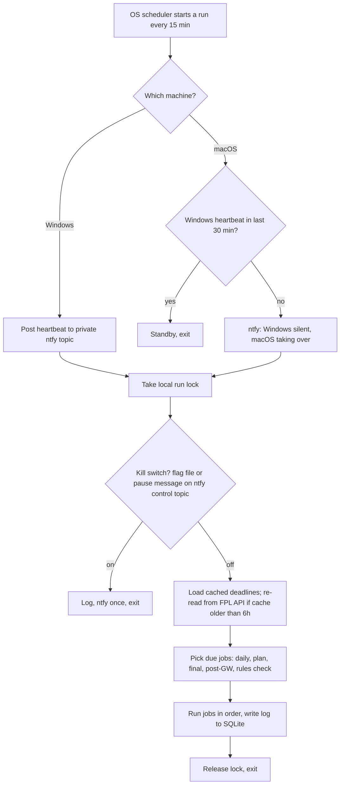
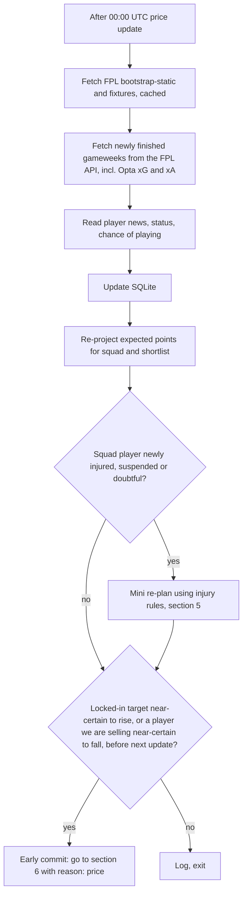
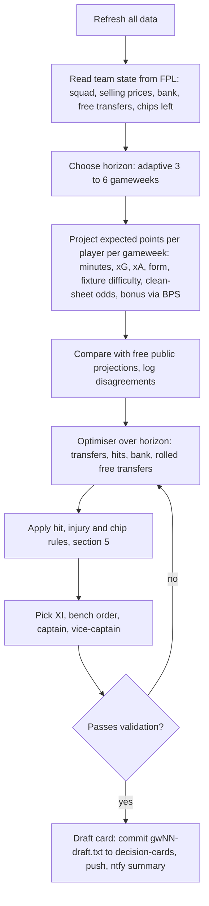
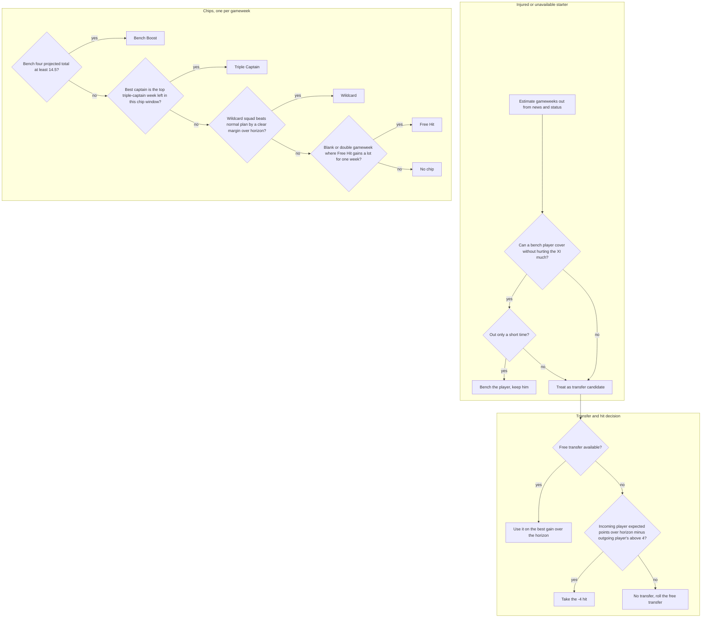
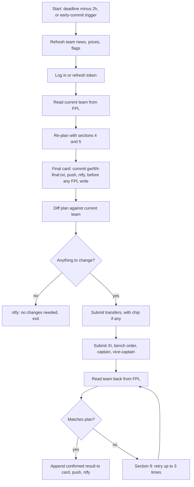
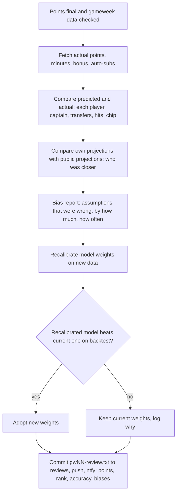
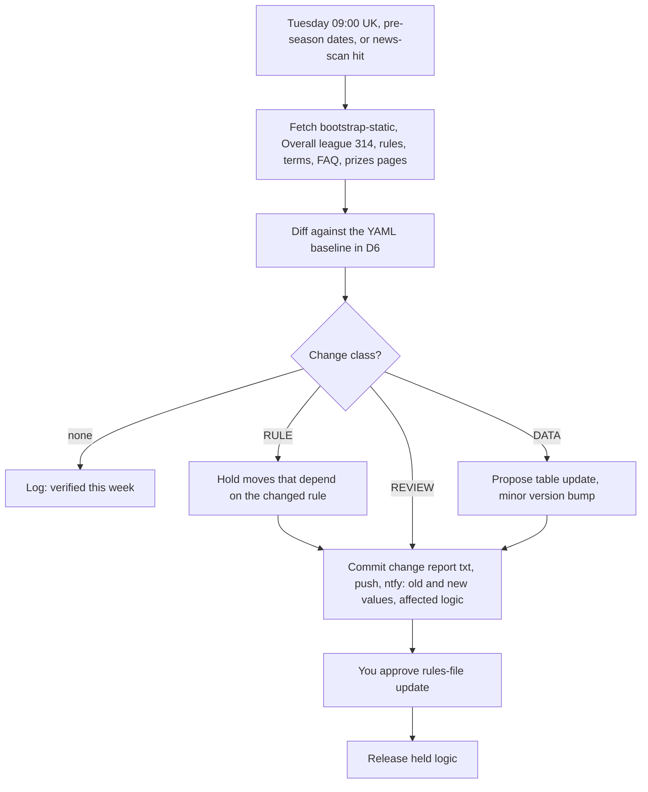
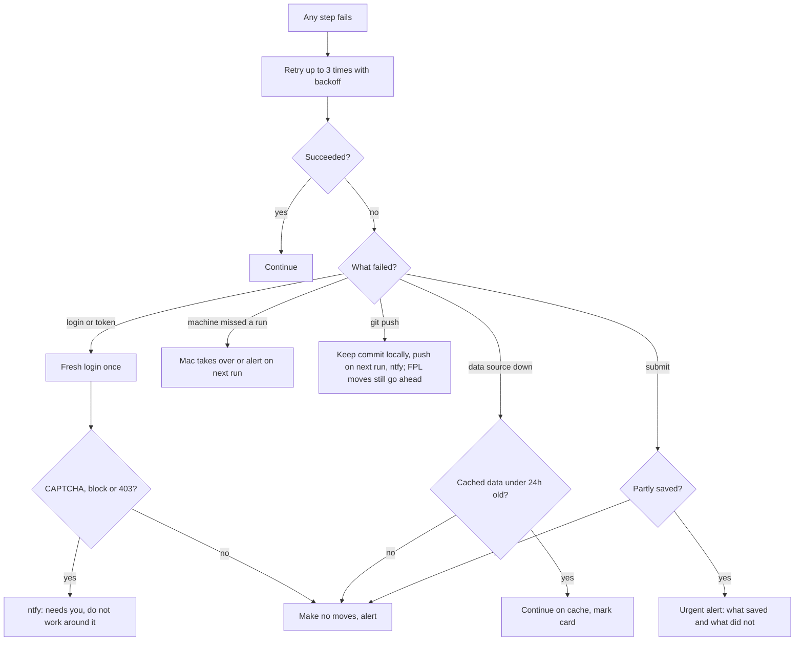

# FPL bot system flow

Master reference for the bot's design. Approved 2026-10-30 (v0.3 of the reviewed flowchart); updated 2026-10-30 at the owner's request: no dry run, the bot plays from GW9, and data comes from the FPL API plus a public archive instead of Understat/FBref. Rules come from `docs/fpl-rules-context.md`; where this file and the rules file disagree, the rules file wins.

Summary: fully autonomous (no human veto) · Windows primary, macOS backup · Python + SQLite · free data only · decision cards as .txt files in this repo · ntfy push alerts · goal: maximise points and overall rank.

## 0. Overview

The bot is a short program that the operating system starts every 15 minutes. Each run checks what is due against the live FPL deadlines and does only that job, then exits. Moves can be committed at any point in the week, but every commit is preceded by a decision card, saved as a text file in the GitHub repo.

## 1. Setup and go-live

You created the FPL account for `soohzabimaru864@gmail.com` yourself on 2026-10-30, so the bot only ever logs in. There is no dry run: the bot plays from GW9 (deadline Sat 31 Oct 2026, 11:00 UTC). The go-live check is a smoke test that the whole workflow produces a valid team and decision card.

Automated login and submission can't be built and safely tested before the GW9 deadline, so GW9 is entered by you, by hand, exactly as the bot's decision card says. From GW10 the bot submits itself, after a check-only login run (log in and read the team, change nothing) proves the login works.

### Needed from you

- A GitHub fine-grained token limited to this one repo with Contents read and write, so the bot can push decision cards. Stored in the keychain, never in the repo.
- Run the bot's setup command once on each machine (Windows and Mac). It asks for the FPL password with hidden typing and saves it to the OS keychain; nothing is written to the repo. Under the hood this is the same as `python -m keyring set fpl-bot soohzabimaru864@gmail.com`.
- ntfy: install the free ntfy app (iOS or Android) and subscribe to two topic names the bot generates at setup: one for alerts, one for pause/resume commands. Topic names are long random strings, because anyone who knows a topic name can read it.

### Notes

- Secrets go in the OS keychain, which is a git-ignored store outside the repo, in line with CLAUDE.md.
- A CAPTCHA or other human check is never bypassed. The bot stops and asks you.
- The bot logs in from your home network only. FPL blocks cloud servers.

## 2. Scheduler and failover

Task Scheduler (Windows) and launchd (macOS) each start a run every 15 minutes. A short scheduled run survives reboots and crashes better than a long-running process. The Mac stays idle unless the Windows machine has gone quiet.

### Why a double submit can't happen

- Before any write, the bot reads the current team from FPL and applies only the difference from its plan. If Windows already submitted, the Mac finds nothing to change.
- The heartbeat check means the Mac only acts when Windows has been silent for 30 minutes.

### Notes

- The heartbeat goes over ntfy. It's free and needs no shared drive.
- 15-minute tick and 30-minute failover window.

## 3. Daily refresh

Runs once a day after the 00:00 UTC price update. This is where an early commit can start: the bot may submit days before the deadline when waiting would cost money.

### Notes

- Price signal: `price_change_percent` and `price_change_projections`, ignored while `price_change_calibrating` is true.
- A locked-in target is a player who appears in the plan's transfers in every one of the last 2 plan runs.
- Near-certain means a projected change at the next update with predictor progress of 100% or more.

## 4. Weekly plan (deadline minus 24h)

The full weekly plan, sent as a draft decision card. Nothing is submitted at this stage unless an early-commit trigger fires.

### Validation checks

- 15 players, 2/5/5/3, max 3 per club, budget computed from selling prices in tenths.
- Valid formation, reserve goalkeeper in bench slot 12.
- At most 20 transfers unless Wildcard or Free Hit is played; one chip per gameweek; no Free Hits in consecutive gameweeks.
- First-half chips used by the GW19 deadline, 1 Jan 2027 18:30 UTC.

### Where cards go

- `decision-cards/2026-27/gw10-draft.txt`, `gw10-final.txt`, plus `reviews/2026-27/gw10-review.txt` and `rules-alerts/`. The bot commits and pushes each one; ntfy carries a short summary and the file path.

### What a decision card contains

- Every move: transfers, hits, chip, XI, bench order, captain and vice-captain.
- For each move: the expected-points numbers behind it, the alternatives it beat and by how much, the assumptions it relies on (minutes, fixtures, injuries), and where the bot's projection differs from public projections.
- Confidence for each assumption, so you can see which ones to penalise in code if they turn out wrong.
- How the squad was built: the chain of reasoning from the goal and budget through spend by position, formation, club stacks, bench and captaincy (added 2026-10-30 at the owner's request).
- Why each player: his projection, minutes record, where his points come from (with per-90 evidence), his fixture run, his value rank in his position, and how he compares with the best similar-priced alternative.

## 5. Hit, injury and chip rules

Your rules as the bot applies them. The Triple Captain, Wildcard and Free Hit triggers are my proposals.

### Your rules

- Hit: only if the incoming player's expected points over the horizon beat the outgoing player's by more than 4.
- Late injury with no free transfers left: try the bench first, judged on expected time out.
- Bench Boost: when the four bench players' projected total for the gameweek is 14.5 or more.
- Triple Captain inputs: projected points, fixture difficulty, head-to-head history, form, xG, xA.

### My proposals

- If no Bench Boost week in the chip window reaches 14.5, use it in the highest week left before the window closes.
- Short time out means 2 gameweeks or fewer.
- Triple Captain when this week's best captain score is the highest projected for the rest of the chip window.
- Owner's Triple Captain rule (2026-11-05): play it when the captain projects 8+ points, judging the rest of the chip window (to GW19) over owned players and players affordable with one transfer. A later week justifies holding only if it is clearly better (more than 1 point, the bot's margin).
- Owner's transfer rules (2026-11-05): saving free transfers is the default (they cover later injuries, form dips and fixture swings without hits). A transfer is made when the incoming player projects 10+ points more over the 3-6 week horizon, or when the outgoing player is out long-term (no expected points in 3+ horizon weeks), in which case a smaller upgrade, even a bench one, is fine. Incoming players must be fully available. A hit needs the gain to beat 4 more.
- Owner's rules not yet built (2026-11-05): after a Wildcard, hold transfers for 3-6 weeks unless injuries, a major form dip, a fixture swing or a key teammate's absence (e.g. Palmer and Rogers with or without João Pedro) changes a player's outlook; with saved transfers, short-term punts before a Wildcard are fine; use midweek European and cup minutes to judge league starts; avoid incoming players likely to lose value or whose cost blocks a later upgrade. Chips after GW19 (blanks and doubles) follow the owner's later instructions.
- Wildcard when the unlimited-transfer squad beats the normal plan by 15 or more expected points over the horizon.
- Free Hit for blank or double gameweeks when it gains 10 or more expected points for that week.
- Order of checks when two chips qualify: Bench Boost, Triple Captain, Wildcard, Free Hit.

## 6. Final run and submit

Runs at deadline minus 2h, or earlier on an early-commit trigger. Moves are saved by deadline minus 90 minutes, then read back to confirm.

### Notes

- Late changes: if an early commit already happened, the final run still re-plans and can change the XI, captain and free transfers left.
- Wildcard and Free Hit can't be undone once played, so they are submitted only from the final run, never on an early commit.
- No human veto. The card explains the decision; it does not wait for a reply.

## 7. Post-gameweek review

Runs once points are final, at 09:00 UK on the day after the last match, and the gameweek is marked data-checked.

### Your part

- Read the review and decision cards, then change the code to fix biases and penalise wrong assumptions. The bot only tunes model weights itself; code changes are yours.

## 8. Rules-change check

Part D of the rules file. Weekly on Tuesday 09:00 UK, plus a daily news scan.

## 9. Failure handling

Applies to every stage. The safe default is to make no moves: FPL keeps the previous team.

## Approved decisions

These were the review items on the flowchart, approved as written.

1. No dry run (changed 2026-10-30): the bot plays from GW9. GW9 is entered by hand from the decision card; automated submission starts at GW10 after a check-only login run.
2. The FPL account was created by the owner on 2026-10-30; the bot logs in and never signs up.
3. Secrets are stored in the Windows Credential Manager and macOS Keychain.
4. Card file layout under `decision-cards/`, `reviews/` and `rules-alerts/`, and that a failed git push never blocks FPL moves.
5. Failover: a 15-minute tick, and the Mac takes over after 30 minutes without a Windows heartbeat, sent over ntfy.
6. Early commits only for price moves. Wildcard and Free Hit only in the final run.
7. The thresholds in section 5: 2 gameweeks as a short absence, Wildcard at 15+ points over the horizon, Free Hit at 10+ points in the week, and the Triple Captain and Bench Boost fallbacks.
8. The bot adopts recalibrated model weights only when they beat the current model on backtest. Code changes stay with you.
9. The repo is private (since 2026-10-30), so decision cards are not published. Keep it private.
11. Signing in (added 2026-10-30): the bot signs in through a real browser on the owner's machine, because FPL's login runs behind Cloudflare and DataDome bot checks. It makes its requests from inside the page using the login token the site itself creates, held in memory only. The browser profile (session cookies) lives in the local data folder, never the repo, so sign-ins are rare. A CAPTCHA or other human check stops the bot and alerts the owner.
10. Data sources (changed 2026-10-30): the FPL API (which carries Opta xG and xA per player per match) and the public vaastav/Fantasy-Premier-League archive (MIT licence) for past seasons. Understat and FBref are not used.

## Schedule

| Timing | What happens |
|---|---|
| Every 15 min | Scheduler run, heartbeat, kill-switch check |
| Daily after 00:00 UTC | Data refresh, price watch, possible early commit |
| Deadline − 24h | Weekly plan, draft card pushed to repo |
| Deadline − 2h | Final run, final card, submit by deadline − 90 min |
| 09:00 UK day after last match | Post-gameweek review and recalibration |
| Tuesday 09:00 UK | Rules-change check |
